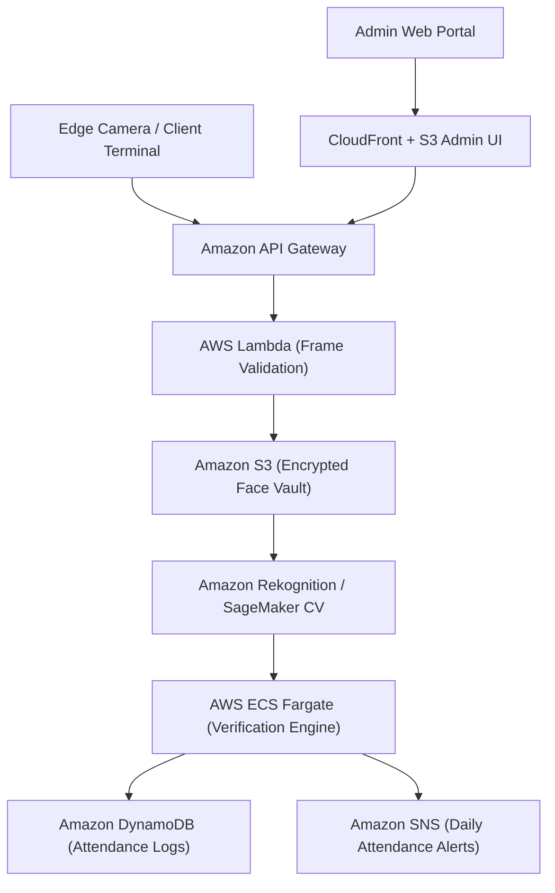

# VisagePass — Edge Biometric Attendance & Identity Verification

[](#aws-cloud-architecture)
[](#computer-vision-pipeline)
[](#branch-architecture)
[](LICENSE)

> Enterprise contact-free biometric attendance verification system utilizing 128-dimensional deep metric facial embeddings, anti-spoofing liveness checks, and AWS cloud audit trails.

---

## 1. Executive Brief
Manual roll calls and fingerprint scanners present throughput bottlenecks and hygiene challenges. **VisagePass** provides automated optical facial detection, extracting 68 facial landmarks to formulate 128-dimensional Euclidean feature vectors that achieve >99.38% verification accuracy under variable lighting.

* **Original Implementation**: Local Tkinter & Flask attendance logger.
* **Preservation Snapshot**: Original code preserved on branch [`Ex`](https://github.com/prak05/VisagePass-Biometric-Attendance/tree/Ex).
* **Modernized Core**: Decoupled asynchronous worker architecture with AWS Cloud integration.

---

## 2. AWS Cloud Architecture



### AWS Service Composition
* **Biometric Vector Matching**: **Amazon Rekognition** Collections with fallback to **SageMaker** custom Dlib Docker container.
* **Event-Driven Pipeline**: S3 bucket triggers invoking Lambda functions for thumbnail generation and EXIF sanitization.
* **Audit Persistence**: **Amazon DynamoDB** with TTL for real-time punch cards and daily summary aggregates.
* **Container Orchestration**: **AWS ECS Fargate** executing background embedding computations.

---

## 3. Code Improvements & Quality Standards
1. **Liveness Verification**: Integrated eye-blink and head-pose ratio checks to eliminate 2D photo spoofing attacks.
2. **Vector Indexing**: Replaced linear Euclidean distance scans with an indexed KD-Tree / HNSW vector graph for O(log N) lookup speeds.
3. **Containerized Deployment**: Multi-stage `Dockerfile` stripping X11/Tkinter dependencies for headless cloud execution.

---

## 4. Run & Deployment Runbook

### Local Docker Mode
```bash
docker build -t visagepass-engine .
docker run -p 5000:5000 -e RUN_MODE=local visagepass-engine
```

### AWS Cloud Deployment
```bash
cd infra/aws
terraform init
terraform apply -var="environment=production"
```

---

## 5. Branch Architecture
* [`main`](https://github.com/prak05/VisagePass-Biometric-Attendance/tree/main): Cloud-ready microservices architecture with AWS adapters.
* [`Ex`](https://github.com/prak05/VisagePass-Biometric-Attendance/tree/Ex): Preserved original Tkinter + CSV codebase.
